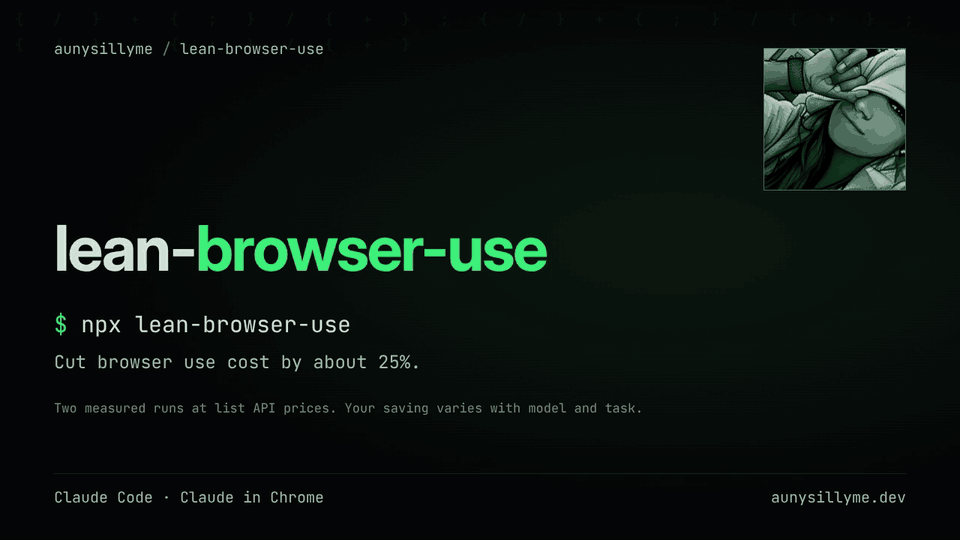

# lean-browser-use

[](https://www.npmjs.com/package/lean-browser-use)
[](https://github.com/aunysillyme/lean-browser-use/actions/workflows/check.yml)
[](LICENSE)
[](package.json)

**Cut browser use cost by about 25% in Claude Code: run page work in a fresh runner, send it in bulk, and see your own saving.**

For Claude Code users who run browser work in their sessions.
You get a skill, a runner agent (a fresh subagent that does the browser work), three hooks and a token meter (the `measure` command that counts tokens per step).
Next: start a fresh Claude Code session and ask it to use the `lean-browser-use` skill.

Bulk means many steps and reads sent in one call; a packet is the brief that carries those steps.
A guard is a small hook that blocks a wasteful or unsafe step.

In two measured runs the same browser task cost 3% and 25% less than in a plain session, about 14% less together (list API prices).
A browser step re-reads about 3x fewer tokens in the runner; the whole run reads a few percent more tokens, but the runner uses a cheaper model, so the bill falls: [see the benchmark](docs/benchmark.md).

```sh
npx lean-browser-use
```

`npx` runs the package without a permanent install.



Undo it with `npx lean-browser-use --uninstall`. Preview the install with `npx lean-browser-use --dry`.

## What it does

| Part | What you get |
| --- | --- |
| Method skill | A route table for public pages, repeated reads, forms, and logged-in work. |
| Subagent runner | Browser execution in a fresh context, with named fields and an evidence handoff. |
| Packet briefs | Paste-ready scope, code, permissions, stop conditions, and cleanup checks. |
| Pick guard | A session-bound browser choice before page actions. |
| Retry guard | A stop on repeated waits, reloads, and fruitless reads. |
| Batch nudge | A reminder to combine predictable actions. |
| Optional page reader | Compile extraction once, then run it as code. |
| Optional search companion | Find links through your SearXNG instance (a self-hosted search engine), then read selected pages. |
| Token meter | Compare main and runner browser context in your local transcripts. |
| Installer and doctor | Managed files, preserved settings, health checks, and hash-aware removal. |

The installer has 0 runtime dependencies. [Package measurements](proof/results.json) include the reproduction commands and measurement dates.
The installer manages the package files and hooks in your Claude config, works offline, and leaves optional tool installation to you.

## What it saves

| Measurement | Plain session | Skill and runner | Change / token ratio |
| --- | --- | --- | --- |
| Run 1 cost | $0.5975 | $0.5787 | -3.15% |
| Run 2 cost | $0.5779 | $0.4319 | -25.26% |
| Per browser step (median tokens) | 188,487 | 59,725 | 3.16 |
| All browser steps | 1,506,374 | 725,151 | 2.08 |
| Everything the run read | 2,657,290 | 2,846,792 | 0.93 |

Savings vary with model, task and session size; measure your own transcripts.
Read [the benchmark and how to reproduce it](docs/benchmark.md), then measure your own transcripts.

## After you install

1. Start a fresh Claude Code session and ask it to use the `lean-browser-use` skill.
2. Run `npx lean-browser-use doctor` to check files, hooks, and available companion tools.
3. Try: "Use lean-browser-use to read the title from https://example.com, save the evidence, verify it, and report cleanup."

For logged-in work, choose your Chrome profile by name when asked. The runner receives that browser's deviceId (the id Claude in Chrome gives each connected browser) and a named tab.
The subagent runner runs the same packets on its own; a cheap helper is another option.
See [installation and activation](docs/install.md) for target directories and optional companions.

## Part of a set

| Package | What it gives |
| --- | --- |
| **lean-browser-use** | Cut browser use cost by about 25% in Claude Code: fresh runner subagent, bulk reads, three guards and a token meter. One npx command |
| [lean-computer-use](https://github.com/aunysillyme/lean-computer-use) | Background Mac computer control for AI agents: desk tools, a fresh runner subagent, retry guards and a transcript token meter, installed with one command |

## Measure your own saving

```sh
lean-browser-use measure
```

The table compares main and runner groups: steps, median, p90, total input-context tokens, and reread share.
The summary includes a main-to-runner median ratio when enough steps are present and a count of skipped lines.
It measures context volume and reports counts without exposing message text or tool inputs.
See [how the meter counts](docs/measure.md) to choose a transcript directory, filter dates, or request JSON.

## Common questions

### How do I install browser-use tools for Claude Code?

Run `npx lean-browser-use`, then start a fresh Claude Code session and invoke the skill.
The installer copies the method, runner, briefs, and guards into your selected Claude config directory.

### Can a subagent run browser work on its own?

Yes: the subagent runner handles the full browser route with the same packets.
Run `npx lean-browser-use doctor` to inspect the tools your machine provides, then follow the [route table](skills/lean-browser-use/references/route-by-job.md).

### How do I install into just this project?

Run `npx lean-browser-use --project` to target the current project's `.claude` directory.
Check it with `npx lean-browser-use doctor --claude-dir ./.claude`.

### How do I add the page reader and search?

Run `npx lean-browser-use --with-reader` to copy both companions.
The reader and search companions use tools you install separately; see their setup guides: [reader](docs/reader.md) and [search](docs/search.md).

### How do I check browser hooks after installing?

Run `npx lean-browser-use doctor`; hook behavior on your Claude Code version is confirmed there.
For payload examples and stop rules, read [the guards guide](docs/guards.md).

## Uninstall

```sh
npx lean-browser-use uninstall
```

Preview with `npx lean-browser-use uninstall --dry`.
Removal uses install-time hashes: edited files stay and are listed, while owned hook registrations are removed from settings.
Use `--claude-dir` to target the same directory as the install; follow printed manual steps for hooks pasted by hand.

## Read next

- [Install and manage](docs/install.md): every flag, target path, health check, and removal behavior.
- [How the method works](docs/how-it-works.md): prepare, route, batch, verify, and clean up.
- [Guards](docs/guards.md): selection, retry bounds, batching, and fail-open checks.
- [Page reader](docs/reader.md): compile a public extraction and reuse it as code.
- [Search](docs/search.md): find URLs with the optional SearXNG companion.
- [Benchmark](docs/benchmark.md): the paired run, exact counts, and how far to trust the ballpark.
- [Measure](docs/measure.md): count local browser context and read the comparison.
- [Provenance](docs/PROVENANCE.md): public names, upstream ideas, and evidence boundaries.

**For agents:** [llms.txt](llms.txt) maps the docs; [AGENTS.md](AGENTS.md) defines repository work. Use `npx lean-browser-use doctor` for a headless check.

## Contributing

Bring a reproducible browser failure, a tool-family fixture, a reader spec, or a docs fix.
[CONTRIBUTING.md](CONTRIBUTING.md) gives the checks and review expectations.

## Credits

- [trycua/cua](https://github.com/trycua/cua), MIT: the sibling's background native-app driver.
- [Jev research client / typesafe-sdk](https://pypi.org/project/typesafe-sdk/) and [its source](https://github.com/typesafe-ai/typesafe-sdk-python), MIT: index-choice and packet techniques.
- [browser-use/jev-ultrafast](https://github.com/browser-use/jev-ultrafast), MIT: packet ideas.
- [Crawl4AI](https://github.com/unclecode/crawl4ai), Apache-2.0: reader fetching and text extraction.
- [SearXNG](https://github.com/searxng/searxng), AGPL-3.0: the search container referenced by the companion.
- [rtk](https://github.com/rtk-ai/rtk), Apache-2.0: shell-output compression techniques.
- [fetchapi.co](https://fetchapi.co): the compile-once idea, reimplemented here from scratch; idea credit only.
- [Anthropic's Claude in Chrome](https://claude.com/chrome): the logged-in browser integration, under Anthropic's service terms.
- [Keep a Changelog](https://keepachangelog.com), MIT, and [Contributor Covenant](https://www.contributor-covenant.org), CC-BY-4.0: repository conventions.

Credits describe each upstream contribution; see [CREDITS.md](CREDITS.md).

## License

[MIT](LICENSE). Copyright Auny LLC and contributors.
